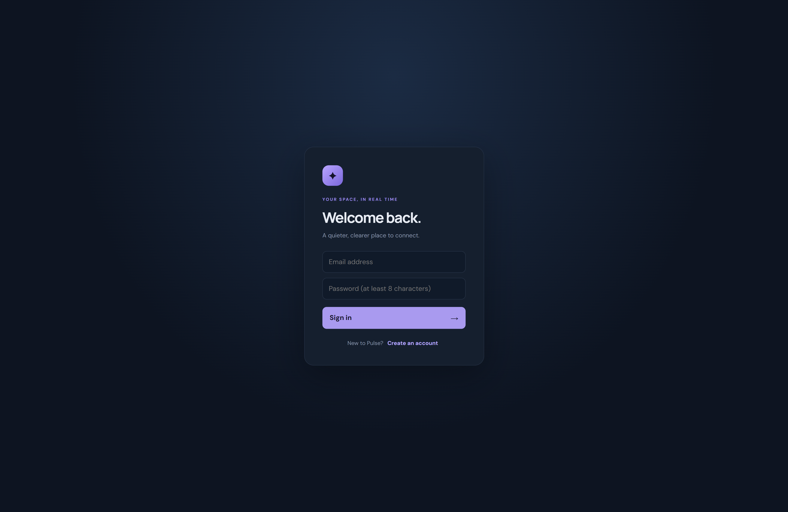
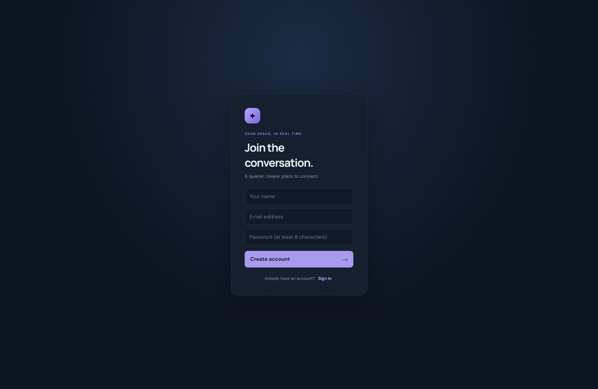
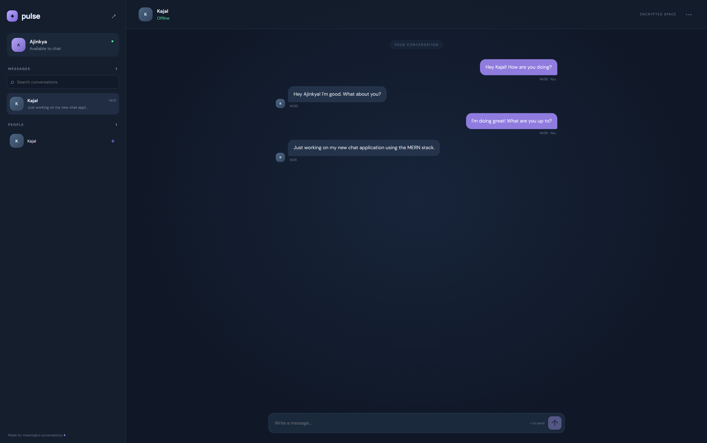

# 💬 Real-Time Chat Application

<p align="center">
  A modern, full-stack real-time messaging application built using the MERN stack and Socket.IO.
</p>

<p align="center">
  
  
  
  
  
  
  
</p>

---

## 📸 Screenshots

<!-- Replace the image paths with your actual screenshots -->

### Login Page



### Register Page



### Chat Dashboard



---

## ✨ Features

- 🔐 **User Authentication** – Secure registration and login using JWT.
- 💬 **Real-Time Messaging** – Instant message delivery using Socket.IO.
- 👥 **User Management** – Browse registered users and start conversations.
- 🟢 **Online Status** – See which users are currently online.
- ⌨️ **Typing Indicators** – Know when someone is typing.
- 💾 **Message Persistence** – Store conversations and messages in MongoDB.
- 📩 **Conversation History** – Retrieve previous messages.
- 📱 **Responsive Design** – Modern interface for desktop and mobile devices.
- 🔒 **Password Hashing** – Secure password storage using bcrypt.
- 📨 **Unread Message Support** – Track which users have read messages.

## 🛠️ Tech Stack

**Frontend**

- React.js
- Vite
- CSS3
- Socket.IO Client

**Backend**

- Node.js
- Express.js
- Socket.IO

**Database**

- MongoDB
- Mongoose

**Authentication & Security**

- JSON Web Token (JWT)
- bcrypt.js

## 📂 Project Structure

```text
mern-realtime-chat/
│
├── client/
│   ├── public/
│   ├── src/
│   │   ├── App.jsx
│   │   ├── main.jsx
│   │   └── styles.css
│   ├── index.html
│   └── package.json
│
├── server/
│   ├── src/
│   │   ├── config/
│   │   │   └── db.js
│   │   ├── middleware/
│   │   │   └── auth.js
│   │   ├── models/
│   │   │   ├── User.js
│   │   │   ├── Conversation.js
│   │   │   └── Message.js
│   │   ├── routes/
│   │   │   ├── auth.js
│   │   │   ├── users.js
│   │   │   └── conversations.js
│   │   ├── index.js
│   │   └── socket.js
│   ├── .env.example
│   └── package.json
│
└── README.md
```

## ⚙️ Installation & Setup

### 1. Clone the Repository

```bash
git clone https://github.com/your-username/mern-realtime-chat.git
cd mern-realtime-chat
```

### 2. Backend Setup

```bash
cd server
npm install
```

Create a `.env` file inside the server directory:

```env
PORT=5000
MONGO_URI=mongodb://127.0.0.1:27017/mern_realtime_chat
JWT_SECRET=your_long_random_secret_key
CLIENT_URL=http://localhost:5173
```

Configure your MongoDB connection string and JWT secret.

Start the backend server:

```bash
npm run dev
```

### 3. Frontend Setup

Open another terminal:

```bash
cd client
npm install
```

Start the React development server:

```bash
npm run dev
```

### 4. Open the Application

Visit:

```text
http://localhost:5173
```

The application is now ready to use!

## 🔌 API Endpoints

| Method | Endpoint                          | Description                   |
| ------ | --------------------------------- | ----------------------------- |
| POST   | `/api/auth/register`              | Register a new user           |
| POST   | `/api/auth/login`                 | Authenticate user             |
| GET    | `/api/users`                      | Get all users                 |
| GET    | `/api/conversations`              | Get user conversations        |
| POST   | `/api/conversations`              | Create or find a conversation |
| GET    | `/api/conversations/:id/messages` | Get conversation messages     |

Protected routes require a JWT access token in the Authorization header.

## ⚡ Socket.IO Events

**Client Events**

- `join` – Join a conversation room.
- `private_message` – Send a real-time message.
- `typing` – Notify others when typing.
- `stop_typing` – Notify others when typing stops.

**Server Events**

- `online_users` – Broadcast online users.
- `receive_message` – Receive new messages.
- `conversation_updated` – Notify clients of conversation updates.
- `typing` – Receive typing notifications.
- `stop_typing` – Receive stopped-typing notifications.
- `message_error` – Handle message errors.

## 🔮 Future Improvements

- Group chat functionality.
- Image and file sharing.
- Message read receipts.
- Message editing and deletion.
- Push notifications.
- Voice and video calling.
- End-to-end encryption.
- Message search and pagination.

## 👨‍💻 Author

**Ajinkya Dhatrak**

GitHub: [@ajinkya029](https://github.com/ajinkya029)

---

<p align="center">
  ⭐ If you like this project, consider giving it a star!
</p>
